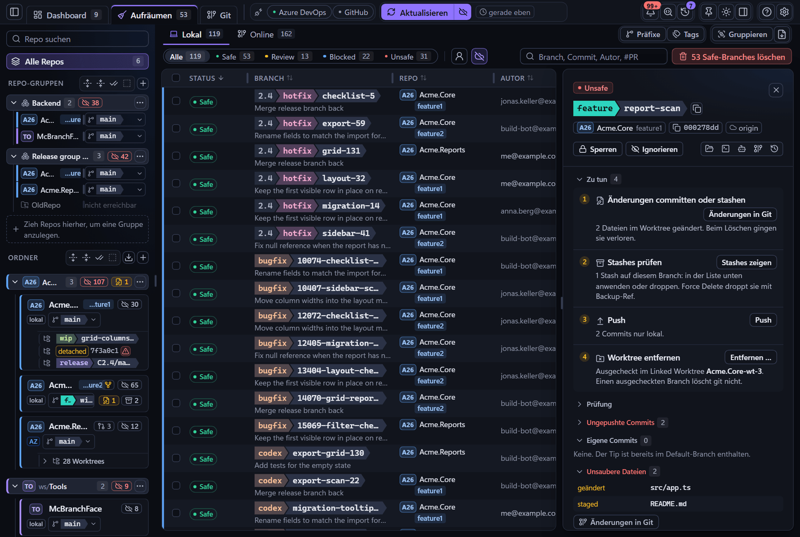

# McBranchFace

<p align="center"></p>

A desktop git tool for many repositories, working copies and agent worktrees, with safe branch cleanup.

<p align="center"></p>

- **Cleanup:** a verdict for every branch (Safe, Review, Unsafe, Blocked) and deletion with a backup you can restore.
- **Git:** changes with diff and staging by hunk, history, branches, fetch, pull and push.
- **Many repos:** the same repository in several folders is recognised; pull requests come from `gh` and `az`.
- **Agents:** create parallel worktrees or clones and copy ready-made prompts.

Built with Tauri 2, Svelte 5 and Rust. It drives your `git`, so your config and credentials work as usual.
Developed and tested on Windows; macOS and Linux have never been built.

## Build

Needs Node 22+, Rust ([rustup](https://rustup.rs)), git and, on Windows, the C++ build tools.

```bash
npm install
npm run tauri dev      # run with hot reload
npm run tauri build    # build the installer
```

## Docs

[Cleanup](docs/cleanup.md) · [Git and tools](docs/git-and-tools.md) · [Safety](docs/safety.md) ·
[Shortcuts](docs/shortcuts.md) · [Development](docs/development.md) · [AGENTS.md](AGENTS.md) ·
[Changelog](CHANGELOG.md)

MIT license, see [LICENSE](LICENSE).
